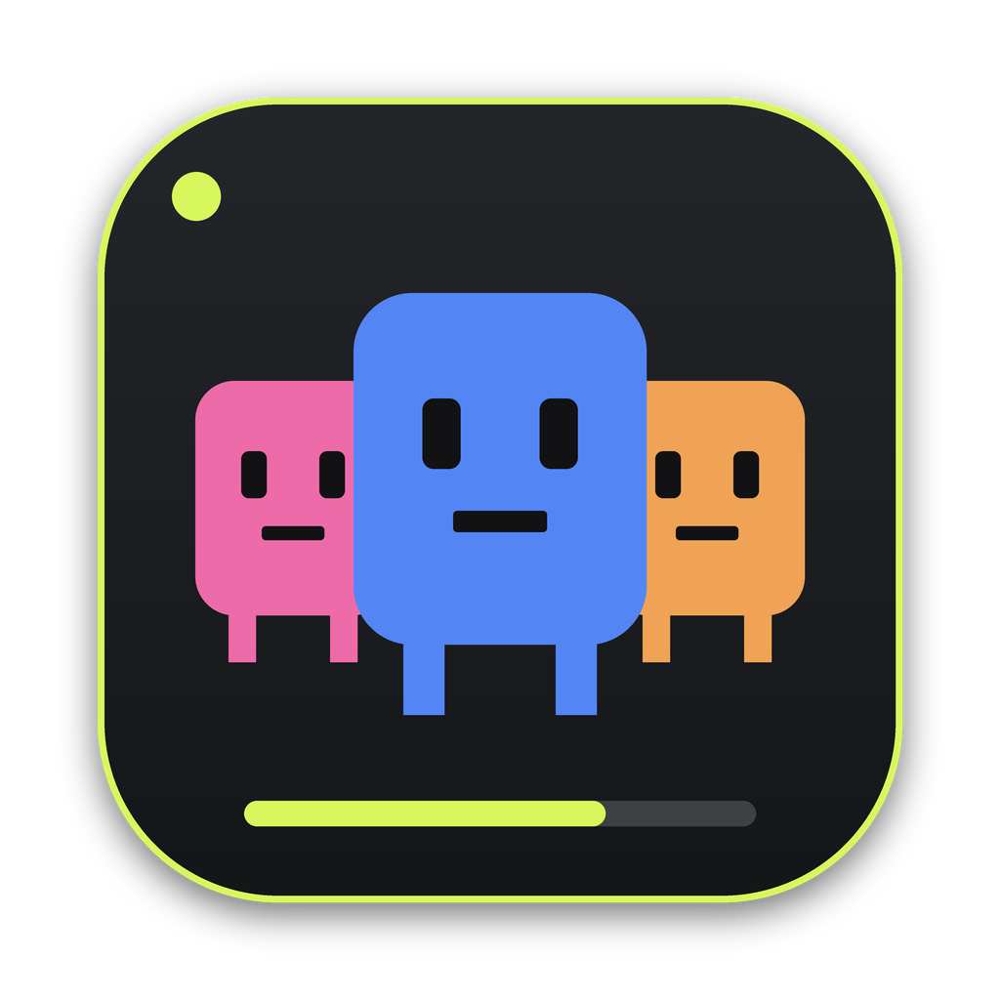
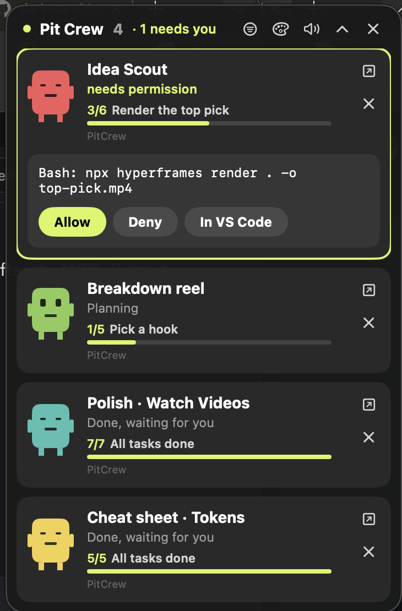
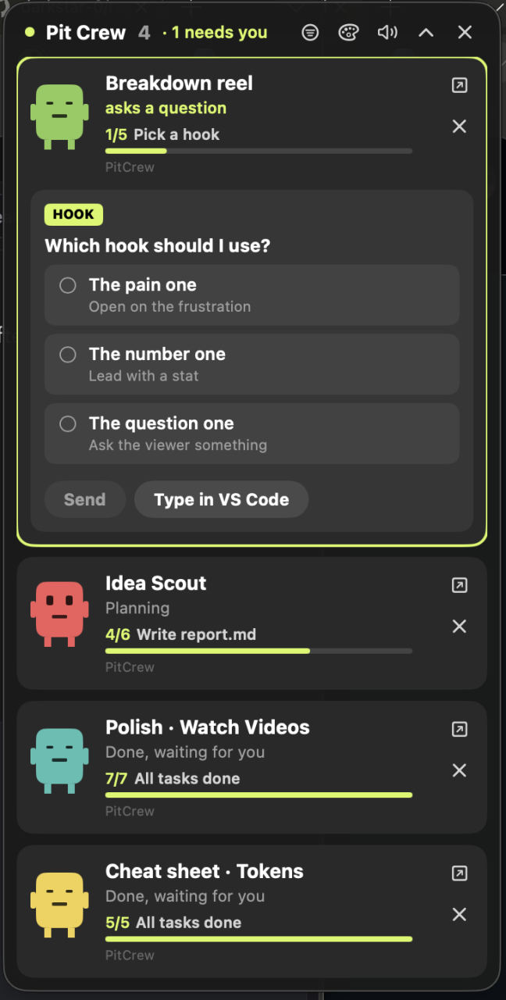
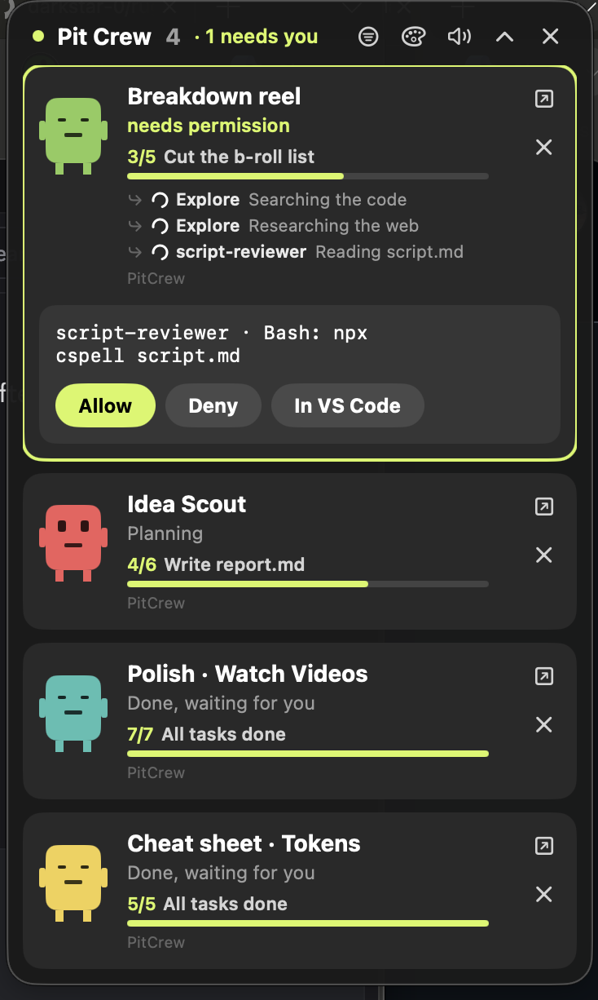
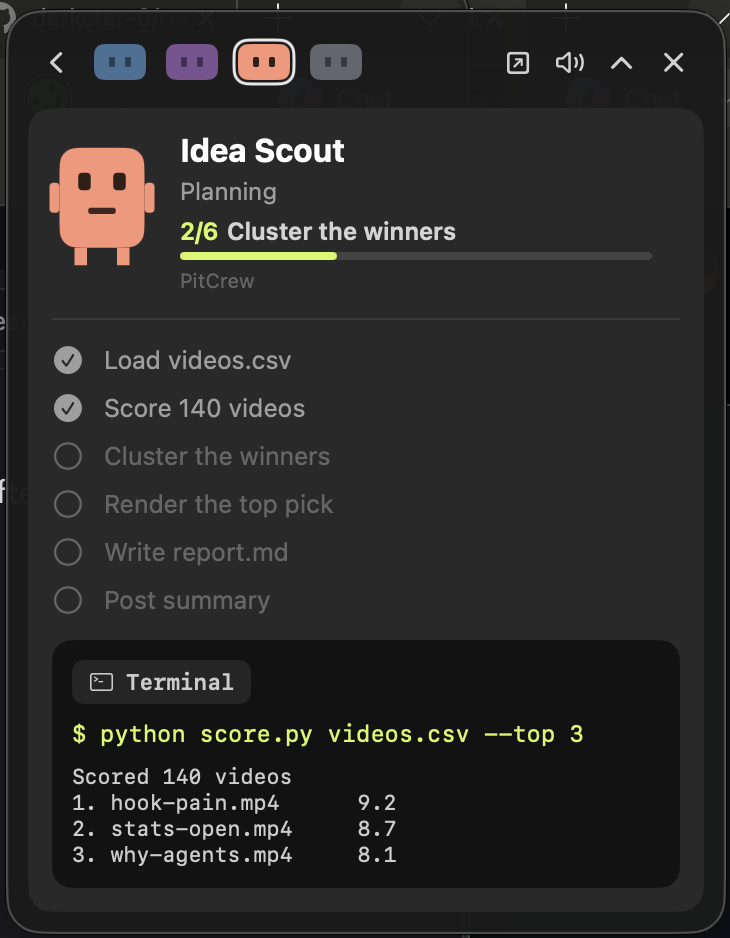
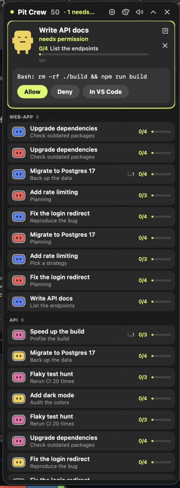
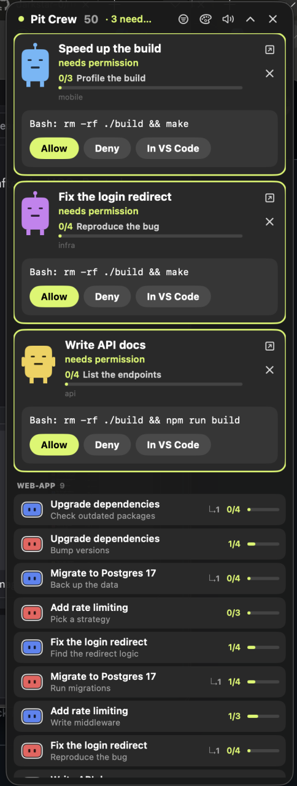
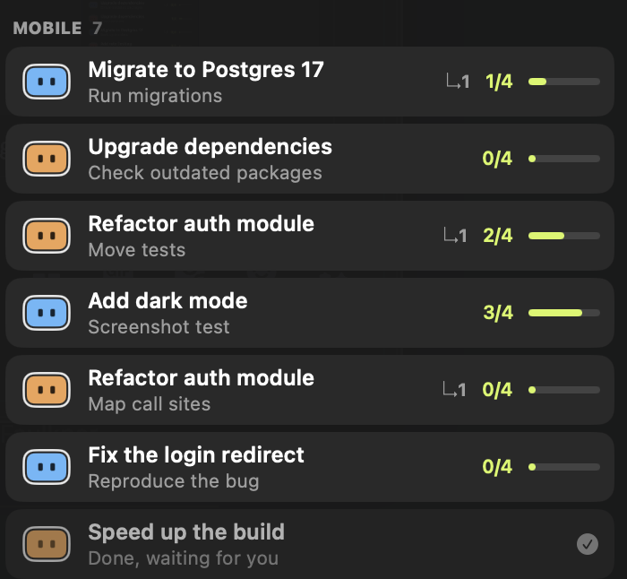
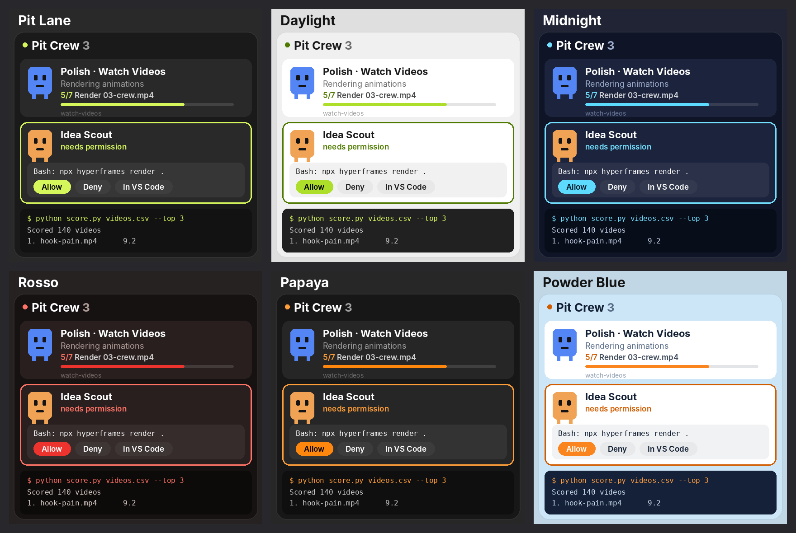

<p align="center">
  
</p>

<h1 align="center">Pit Crew</h1>

<p align="center">
  A floating macOS panel for your Claude Code agents.<br>
  See what every session is doing, and approve or answer them without switching windows.
</p>

<p align="center">
  
</p>

---

Running several Claude Code agents in VS Code tabs means constantly checking which one is
stuck waiting on you. Pit Crew sits in the top-right corner of your screen, across every
desktop, and shows:

- **Every session as a card**: its first prompt as the title, what it's doing right now,
  and a progress bar from its task list
- **When an agent needs you**: the card lights up and plays a sound
- **Allow / Deny** for permission prompts, right on the card
- **Answers to Claude's questions**: pick an option and hit Send
- **A detail view**: click a card for the full checklist and the last terminal command
  with its output
- **↗** to jump straight to that agent's VS Code window
- **Subagents** listed under the agent that started them, each with its own status
  and its own permission prompts
- **Room for a crowd**: past 8 agents it switches to compact rows grouped by project,
  with anything that needs you pinned to the top

Everything runs locally. Pit Crew only listens on `127.0.0.1`.

## Screenshots

<table>
  <tr>
    <td align="center" width="33%"><br><sub><b>Answer Claude's questions</b><br>pick an option and hit Send</sub></td>
    <td align="center" width="33%"><br><sub><b>Subagents</b><br>each with its own status and prompts</sub></td>
    <td align="center" width="33%"><br><sub><b>Detail view</b><br>checklist + last terminal command</sub></td>
  </tr>
  <tr>
    <td align="center"><br><sub><b>50 agents</b><br>compact rows, grouped by project</sub></td>
    <td align="center"><br><sub><b>Needs-you first</b><br>prompts stay pinned at the top</sub></td>
    <td align="center"><br><sub><b>Compact rows</b><br>progress and subagent counts at a glance</sub></td>
  </tr>
</table>

<p align="center">
  <br>
  <sub><b>Six themes</b> plus Auto, which follows macOS light/dark mode</sub>
</p>

## Quick start

Requires macOS 13+ and Xcode or the Command Line Tools (`xcode-select --install`).

```sh
git clone https://github.com/darkstar-0/PitCrew.git
cd PitCrew
make install   # builds PitCrew.app, installs + launches it, and hooks up Claude Code
make demo      # guided tour with fake agents: try every feature in ~3 minutes
```

Then start a **new** Claude Code session (hooks load when a session starts) and
it shows up in Pit Crew.

> **Known issue:** the **Launch at Login** menu item isn't working reliably yet
> (the build script can't code-sign the app on some Macs, and macOS may refuse to
> register an unsigned app). Until it's fixed, add Pit Crew yourself in
> **System Settings → General → Login Items → +** and pick `/Applications/PitCrew.app`.

### All commands

| Command | What it does |
|---|---|
| `make install` | Build `PitCrew.app`, copy it to Applications, launch it, register the hooks |
| `make demo` | Guided tour with four fake agents (Pit Crew must be running) |
| `make crowd` | Stress test with 50 fake agents (`N=72 make crowd` for more) |
| `make app` | Just build `build/PitCrew.app` |
| `make hooks` | Just register the hooks in `~/.claude/settings.json` (safe to re-run) |
| `make run` | Run from source with `swift run` (for development) |
| `make uninstall` | Remove the app, the hooks and `~/.pitcrew` |

The demo also takes `--fast` (shorter pauses) and `--no-wait` (answers prompts
itself): `./scripts/demo.py --fast`.

## Controls

- **Click a card** to open its detail view. The mini robots at the top switch agents; **‹** goes back.
- **≡** shows only the agents that need you.
- **⌃** collapses the panel to a pill ("12 agents · 2 need you"). Click the pill to expand.
- **↗** brings that project's VS Code window to the front.
- **✕** on a card hides it until the agent needs you again. **✕** in the header hides the panel.
- **🔊** mutes the sounds.
- **🎨** cycles through the themes. Or pick one from the menu bar icon → **Theme**.
- **Drag the header** to move the panel. It stays pinned by its top-right corner.
- **Menu bar icon**: Show Pit Crew, Reset Position, Theme, Launch at Login, Quit.

### Lots of agents

- Agents that need you always sort to the top.
- The panel never grows past the bottom of your screen; the list scrolls.
- Past 8 agents, quiet ones shrink to one-line rows grouped by project folder, while
  agents that need you keep their full cards with the Allow/Deny buttons.
- Robots come in 12 colors × 3 head shapes, so 36 agents each look different.
- Chimes are limited to one every 1.5 seconds.

### Subagents

When an agent hands work to subagents (Claude's Task/Agent tool), they appear under
its card: "↳ Explore  Reading Views.swift". The detail view lists them all. If a
subagent asks for permission, the prompt is labeled with its type
("script-reviewer · Bash: …"), and the other subagents keep going. If several
ask at once, the card shows the oldest prompt first and says how many more are waiting.

An agent that launches separate Claude Code sessions (for example with `claude -p`)
gets a separate card for each one, since they're separate sessions.

### Themes

Six built-in themes: **Pit Lane** (the default, graphite + lime), **Daylight**,
**Midnight**, **Rosso**, **Papaya** and **Powder Blue**. **Auto** follows macOS,
using Pit Lane in dark mode and Daylight in light mode. Your choice is remembered.

To add your own, copy one of the `static let` themes in
[`Sources/PitCrew/Theme.swift`](Sources/PitCrew/Theme.swift), change the colors,
and add it to `Theme.all`.

## How it works

```
Claude Code ──hooks──► ~/.pitcrew/hook.sh ──────► Pit Crew (127.0.0.1:7777)
                       ~/.pitcrew/permission.sh ─┘   SwiftUI floating panel
```

`make hooks` adds these [Claude Code hooks](https://code.claude.com/docs/en/hooks)
to `~/.claude/settings.json`, after backing it up. Your other settings are left alone.

| Hook | What Pit Crew does with it |
|---|---|
| `SessionStart` / `SessionEnd` | Adds / removes the card |
| `UserPromptSubmit` | First prompt becomes the card title |
| `PreToolUse` | Status line ("Editing Views.swift"), activity list, terminal command |
| `PostToolUse` | Progress from TodoWrite / TaskCreate / TaskUpdate, command output |
| `Notification` | Lime highlight + sound when Claude is waiting |
| `Stop` | "Done, waiting for you" + sound |
| `SubagentStart` / `SubagentStop` | Subagent rows under the parent's card |
| `PermissionRequest` | Allow / Deny buttons, or the question with its options |

**Permissions and questions.** `permission.sh` posts the request to Pit Crew,
which holds it open until you click. Pit Crew then replies with Claude Code's
decision JSON, `{"decision": {"behavior": "allow"}}` or `"deny"`. To answer a
question, it sends `"allow"` plus `updatedInput.answers` (the question text mapped
to the label you picked).

**It never blocks you.** Pit Crew replies with *no decision*, so Claude Code shows
its normal prompt in the terminal, when:
- the app isn't running
- the panel is hidden
- you click **In VS Code** / **Type in VS Code**
- nobody answers within about 10 minutes

The terminal prompt also stays visible while Pit Crew is waiting, so you can
answer in either place.

## Troubleshooting

- **A session doesn't show up.** Hooks load when a session starts, so start a new
  one after `make hooks`. Check that `~/.claude/settings.json` has `~/.pitcrew/` entries.
- **See what Claude Code is sending.** Every hook payload is logged to
  `~/.pitcrew/events.log`, which is cleared each time the app launches.
- **Port 7777 is taken.** Only one copy of Pit Crew can run at a time. Quit any
  `swift run` copy before opening the app.
- **The output in the detail view lags.** Hooks only report a command's output
  once it finishes, so long-running commands show "running…" until they're done.

## Project layout

```
Sources/PitCrew/     the app (SwiftUI + AppKit, no dependencies)
  AppDelegate.swift    panel window, menu bar, Launch at Login
  EventServer.swift    tiny HTTP server for the hooks
  CrewStore.swift      turns hook events into agent state
  Views.swift          cards, detail view, buttons, robots
  Theme.swift          color themes
hooks/               scripts Claude Code runs + settings installer
scripts/             build-app.sh, install-hooks.sh, demo.py, uninstall.sh
Resources/           Info.plist and the app icon
```

## To-Do

- [ ] **Fix Launch at Login**: code signing in `build-app.sh` fails on some Macs, and
      macOS may refuse to register an unsigned app. First step: run
      `codesign --force --sign - build/PitCrew.app` and look at the error.
- [ ] **"Always allow" button**: stop Claude asking about the same command again
      (via the hook's `updatedPermissions`)
- [ ] **Jump to the exact terminal tab**: a small VS Code extension so ↗ focuses the
      agent's terminal tab, not just its window
- [ ] **Answer plan approvals** (ExitPlanMode) from the panel
- [ ] **Link `claude -p` sessions** back to the agent that started them

## License

[MIT](LICENSE) © 2026 Jack Faulkner
